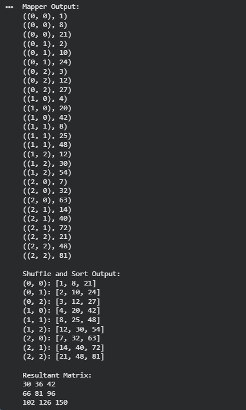

# Exp 01 Matrix Multiplication using MapReduce

**Date:** 25/10/2026

## AIM:
To implement Matrix Vector Multiplication using the MapReduce programming model.
## DESIGN STEPS:

### Step 1:
Clone the repository from GitHub.

### Step 2:
Create a Python/Java project in the preferred IDE (Eclipse/IntelliJ IDEA/VS Code).

### Step 3:
Create the Python/Java program for Matrix Vector Multiplication using the MapReduce concept.

### Step 4:
Implement the **Mapper** phase to generate intermediate key-value pairs from the input matrices.

### Step 5:
Implement the **Shuffle and Sort** phase to group intermediate values based on common keys.

### Step 6:
Implement the **Reducer** phase to compute the final matrix vector multiplication results.

### Step 7:
Compile and execute the program.

### Step 8:
Verify and display the resulting product matrix.

## PROGRAM:

```python

# Matrix Multiplication using MapReduce

A = [
    [1, 2],
    [4, 5],
    [7, 8]
]

B = [
    [1, 2, 3],
    [4, 5, 6]
]

# Mapper phase
def mapper(A, B):
    intermediate = []

    for i in range(len(A)):
        for j in range(len(B[0])):
            for k in range(len(B)):
                intermediate.append(
                    ((i, j), A[i][k] * B[k][j])
                )

    return intermediate


# Shuffle and Sort phase
def shuffle_sort(intermediate):
    grouped = {}

    for key, product in intermediate:
        if key not in grouped:
            grouped[key] = []
        grouped[key].append(product)

    return grouped


# Reducer phase
def reducer(grouped):
    result = {}

    for key, products in grouped.items():
        result[key] = sum(products)

    return result


# Execute MapReduce
mapped_data = mapper(A, B)

print("Mapper Output:")
for item in mapped_data:
    print(item)

grouped_data = shuffle_sort(mapped_data)

print("\nShuffle and Sort Output:")
for key, products in grouped_data.items():
    print(f"{key}: {products}")

final_result = reducer(grouped_data)

print("\nResultant Matrix:")
for i in range(len(A)):
    for j in range(len(B[0])):
        print(final_result[(i, j)], end=" ")
    print()

```
## OUTPUT:


## RESULT:

The Matrix Multiplication using the MapReduce programming model was implemented successfully, and the resultant matrix was computed correctly.
